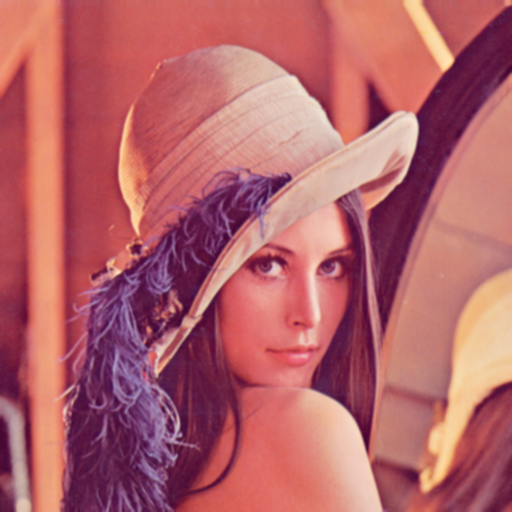

# Усредняющий фильтр Гаусса с переменным размером ядра и параметрами гауссианы.

[Текст задания](./docs/task.md)

## Теоретическая база

### Фильтр Гаусса

Фильтр Гаусса применяется для сглаживания изображения и подавления высокочастотного шума. Каждый пиксель
выходного изображения вычисляется как взвешенная сумма соседних пикселей. Чем дальше соседний пиксель
находится от центра ядра, тем меньше его влияние на результат.

Значение двумерной функции Гаусса определяется выражением:

$$
G(x,y)=\exp\left(-\frac{x^2+y^2}{2\sigma^2}\right),
$$

где x и y -- координаты элемента относительно центра ядра, а $\sigma$ -- среднеквадратическое отклонение
распределения.

После вычисления коэффициенты ядра нормализуются:

$$
K(x,y)=\frac{G(x,y)}
{\sum\limits_i\sum\limits_j G(i,j)}.
$$

Благодаря нормализации сумма всех коэффициентов равна единице. Это позволяет сохранять среднюю яркость
изображения.

[//]: # (### Применение ядра)

[//]: # ()
[//]: # (Размер ядра должен быть положительным нечётным числом.)

[//]: # ()
[//]: # (Для каждого цветового канала результат вычисляется следующим образом:)

[//]: # ()
[//]: # ($$)

[//]: # (I'&#40;x,y,c&#41;=)

[//]: # (\sum_{i=-r}^{r})

[//]: # (\sum_{j=-r}^{r})

[//]: # (I&#40;x+j,y+i,c&#41;\cdot K&#40;j,i&#41;,)

[//]: # ($$)

[//]: # ()
[//]: # (где I -- исходное изображение, I' -- обработанное изображение, а c -- цветовой канал.)

### Влияние параметров

Размер ядра определяет количество соседних пикселей, участвующих в вычислении. Увеличение ядра обычно
усиливает размытие, но одновременно повышает количество вычислений.

Параметр $\sigma$ управляет распределением весов:

- при малом значении большая часть веса сосредоточена около центра;
- при увеличении $\sigma$ соседние пиксели получают более близкие веса;

[//]: # (- слишком большое значение $\sigma$ при небольшом ядре приводит к обрезанию значительной части распределения.)

### Обработка границ

Для пикселей около границы часть ядра выходит за пределы изображения. В программе используется отражение
пикселей относительно границы. <!-- Такой подход уменьшает появление тёмных полос по краям изображения. -->

## Описание разработанной системы (алгоритмы, принципы работы, архитектура)

### Общая структура

Программа реализована на Python с использованием библиотек OpenCV и NumPy. Фильтр Гаусса представлен в двух
вариантах:

1. Библиотечная реализация на основе cv2.GaussianBlur.
2. Ручная реализация прямой двумерной свёртки.

### Параметры запуска

В программу можно передать путь к изображению, размер ядра и значение $\sigma$:

`python main.py image.png --kernel-size 5 --sigma 1.5`

[//]: # (Проверяется, что:)

[//]: # ()
[//]: # (- входной файл существует;)

[//]: # (- размер ядра положительный и нечётный;)

[//]: # (- значение $\sigma$ положительное и конечное;)

[//]: # (- OpenCV смог декодировать изображение.)

### Библиотечная реализация

В библиотечном варианте используется функция cv2.GaussianBlur. Ей передаются то же изображение, одинаковые
размер ядра, значение $\sigma$ и способ обработки границ. Это позволяет сравнивать реализации при
одинаковых исходных условиях.

### Ручная реализация

Ручная обработка состоит из следующих этапов:

1. Создаётся двумерное ядро Гаусса заданного размера.
2. Коэффициенты ядра нормализуются.
3. Изображение расширяется отражёнными граничными пикселями.
4. Для каждого пикселя вычисляется взвешенная сумма его окрестности.
5. Полученные значения округляются и ограничиваются диапазоном от 0 до 255.
6. Результат преобразуется в формат uint8.

Вычисления выполняются в формате float32, чтобы сохранить дробную часть результата во время накопления.

### Проверка результатов

Для оценки различий вычисляется абсолютная разница изображений. Используются следующие показатели:

- максимальная абсолютная ошибка;
- средняя абсолютная ошибка;
- полное поэлементное равенство изображений.

Небольшая разница величиной в один уровень яркости может возникать из-за различий в точности промежуточных
вычислений и правилах округления.

### Измерение производительности

В рамках лабораторной работы было проведено два эксперимента:

- изменение размера ядра при фиксированном значении $\sigma$;
- изменение $\sigma$ при фиксированном размере ядра.

В измерение входит только обработка изображения. Загрузка и сохранение файлов не учитываются. 
Измерения, полученные в ходе эксперимента, отражены в таблицах.
Измерения записывались для библиотечной и ручной реализаций.

Значительная разница во времени выполнения обусловлена реализацией алгоритма.

В ручной реализации вычислительная сложность прямой обработки составляет:

$$
O(H\cdot W\cdot k^2),
$$

где H и W -- высота и ширина изображения, а k -- размер ядра.

## Результаты работы и тестирования системы (скриншоты, изображения, графики, закономерности)

|  |  |  |
|:----------------------------------------:|:---------------------------------------------------:|:---------------------------------------------------:|
|                 Original                 |          OpenCV, kernel size=5, sigma=1.5           |          Native, kernel size=5, sigma=1.5           |

<!-- BENCHMARK_RESULTS_START -->

### Влияние размера ядра при sigma=1.5

| kernel size | sigma |   lib, s | manual, s |   speedup | max error | mean error | equal |
|------------:|------:|---------:|----------:|----------:|----------:|-----------:|:-----:|
|           3 |   1.5 | 0.000198 |  3.139331 | 15887.31x |         1 |   0.006938 | false |
|           5 |   1.5 | 0.000436 |  7.801014 | 17871.74x |         1 |   0.017816 | false |
|           7 |   1.5 | 0.000293 | 15.568871 | 53226.91x |         1 |   0.018180 | false |
|          15 |   1.5 | 0.000704 | 66.075787 | 93804.35x |         1 |   0.038759 | false |

|  |  |
|:---------------------------------------------------:|:---------------------------------------------------:|
|              kernel size=3, sigma=1.5               |              kernel size=5, sigma=1.5               |

|  |  |
|:---------------------------------------------------:|:-----------------------------------------------------:|
|              kernel size=7, sigma=1.5               |               kernel size=15, sigma=1.5               |

### Влияние sigma при размере ядра 7x7

| kernel size | sigma |   lib, s | manual, s |   speedup | max error | mean error | equal |
|------------:|------:|---------:|----------:|----------:|----------:|-----------:|:-----:|
|           7 |   0.5 | 0.000426 | 14.564101 | 34163.98x |         1 |   0.019075 | false |
|           7 |     1 | 0.000443 | 14.807389 | 33447.91x |         1 |   0.005825 | false |
|           7 |   1.5 | 0.000293 | 15.568871 | 53226.91x |         1 |   0.018180 | false |
|           7 |     2 | 0.000491 | 14.589488 | 29725.93x |         1 |   0.017474 | false |
|           7 |     3 | 0.000412 | 14.532981 | 35299.93x |         1 |   0.013254 | false |

|  |  |
|:---------------------------------------------------:|:-------------------------------------------------:|
|              kernel size=7, sigma=0.5               |              kernel size=7, sigma=1               |

|  |  |
|:---------------------------------------------------:|:-------------------------------------------------:|
|              kernel size=7, sigma=1.5               |              kernel size=7, sigma=2               |

|  |  |
|:-------------------------------------------------:|:-:|
|              kernel size=7, sigma=3               |  |

<!-- BENCHMARK_RESULTS_END -->

## Выводы по работе

- Влияние размера ядра: увеличение размера ядра приводит к более сильному размытию изображения.
- Влияние величины $\sigma$: увеличение $\sigma$ приводит к более сильному размытию изображения.
- Производительность: ускорение библиотечной реализации относительно нативной составляет примерно от 16 до 94 тысяч раз.
- Точность: максимальная абсолютная ошибка составила 1 уровень яркости, а средняя -- менее 0.04.

## Использованные источники

1. Gaussian blur // Wikipedia. — URL: https://en.wikipedia.org/wiki/Gaussian_blur
2. Smoothing Images: Gaussian Blurring // OpenCV Documentation. — URL: https://docs.opencv.org/5.0/py_tutorials/py_imgproc/py_filtering/py_filtering.html#gaussian-blurring
